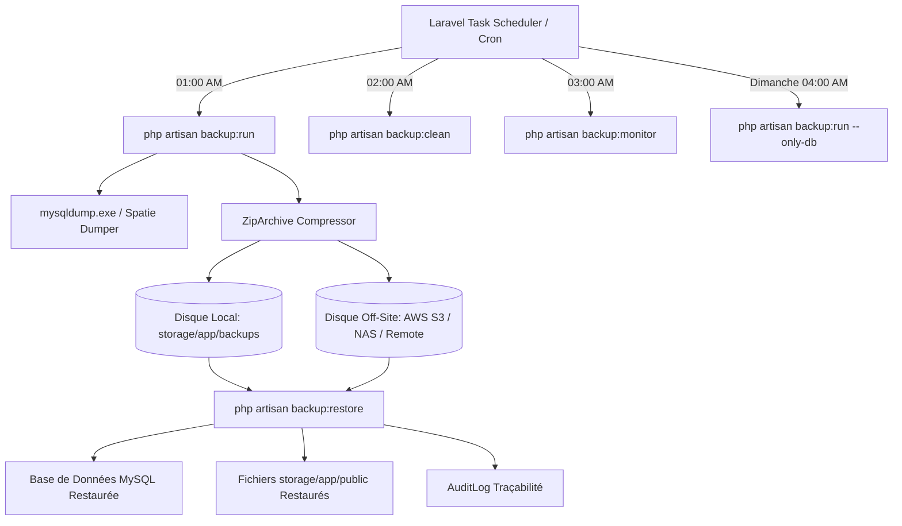

# Guide Stratégique de Sauvegarde & Restauration Automatisée (Backup & Restore Strategy)
**Plateforme Classy-One Academy (Laravel 12 / MySQL)**

---

## 1. Vue d'ensemble de l'Architecture

La stratégie de sauvegarde et de reprise après sinistre (Disaster Recovery) de **Classy-One Academy** assure la protection intégrale et continue de deux composantes critiques :
1. **Base de Données MySQL (`osbt`)** : Utilisateurs, rôles, notes, absences, paiements financiers, historiques d'audit, demandes de documents officiels.
2. **Fichiers et Médias Téléversés (`storage/app/public`)** : Cours (vidéos, supports PDF), certificats de scolarité, reçus de paiements officiels signés, avatars.



---

## 2. Configuration & Paramétrage

### A. Fichiers de Configuration Modifiés
- `config/backup.php` : Définit les sources de sauvegarde, les disques de destination, les vérifications d'intégrité ZIP et la politique de rétention.
- `config/filesystems.php` :
  - Disque `backup` : Stockage local des archives dans `storage/app/backups`.
  - Disque `backup_offsite` : Exportation vers stockage distant / cloud / NAS.
- `config/database.php` : Configuration de l'exécutable `mysqldump` pour Laragon (`dump_binary_path`).
- `routes/console.php` : Planification automatisée du Scheduler Laravel.

### B. Variables d'Environnement (`.env`)
Pour personnaliser les sauvegardes et le stockage distant, ajoutez ou modifiez ces variables dans votre fichier `.env` :

```env
# Nom de l'académie pour les archives
APP_NAME="Classy-One-Academy"

# Chemin vers mysqldump (Automatique sur Laragon Windows, configurable pour Linux/Docker)
DB_DUMP_PATH="C:\laragon\bin\mysql\mysql-8.4.3-winx64\bin"

# Stockage Distant Sécurisé (Off-Site)
BACKUP_OFFSITE_ENABLED=true
BACKUP_OFFSITE_DRIVER=local
BACKUP_OFFSITE_PATH="C:\laragon\backup\Classy-One"

# Notifications d'échec ou de succès
BACKUP_NOTIFICATION_EMAIL="admin@classy-one.test"
```

---

## 3. Stockage Sécurisé Hors-Site (Off-Site Storage)

Pour respecter la règle de sécurité **3-2-1** (3 copies, 2 supports différents, 1 copie hors-site) :

### Option A : Stockage Cloud AWS S3 / Wasabi / MinIO / DigitalOcean Spaces
Configurez dans `.env` :
```env
BACKUP_OFFSITE_DRIVER=s3
BACKUP_AWS_ACCESS_KEY_ID=votre_cle_aws_access
BACKUP_AWS_SECRET_ACCESS_KEY=votre_secret_key
BACKUP_AWS_DEFAULT_REGION=eu-west-3
BACKUP_AWS_BUCKET=classy-one-offsite-backups
BACKUP_AWS_ENDPOINT=https://s3.eu-west-3.amazonaws.com
```

### Option B : Répertoire Réseau / NAS / Disque Externe Dédié
```env
BACKUP_OFFSITE_DRIVER=local
BACKUP_OFFSITE_PATH="//NAS-SERVEUR/backups/Classy-One"
# Ou sur disque externe :
BACKUP_OFFSITE_PATH="D:\ClassyOne_ColdStorage_Backups"
```

---

## 4. Tâches Planifiées (Cron & Task Scheduler)

Dans `routes/console.php`, les 4 tâches automatisées suivantes sont enregistrées :

| Fréquence | Commande | Objectif |
| :--- | :--- | :--- |
| **Tous les jours à 01:00** | `php artisan backup:run` | Sauvegarde complète (Base MySQL + tous les fichiers documents/cours) avec vérification d'intégrité |
| **Tous les jours à 02:00** | `php artisan backup:clean` | Purge des anciennes sauvegardes selon la règle de rétention (Garde 7j tous, 16j quotidiens, 8 sem hebdomadaires, 4 mois mensuels) |
| **Tous les jours à 03:00** | `php artisan backup:monitor` | Vérification de l'état de santé des sauvegardes et alerte en cas d'anomalie |
| **Tous les dimanches à 04:00** | `php artisan backup:run --only-db` | Snapshot allégé et rapide de la base de données |

### Activation du Cron
#### Sous Linux / Serveur de Production :
Ajoutez une ligne dans votre crontab (`crontab -e`) :
```bash
* * * * * cd /chemin/vers/Classy-One && php artisan schedule:run >> /dev/null 2>&1
```

#### Sous Windows / Environnement Laragon :
- **Option 1 :** Lancer le worker scheduler en arrière-plan :
  ```cmd
  php artisan schedule:work
  ```
- **Option 2 :** Créer une tâche planifiée dans le Planificateur de Tâches Windows exécutant `php artisan schedule:run` chaque minute.

---

## 5. Procédure de Restauration d'Urgence (Disaster Recovery)

En cas de sinistre, de corruption de base de données, ou de perte de fichiers, Classy-One propose 3 méthodes de restauration :

### Méthode 1 : Script d'Urgence 1-Clic (`restore-backup.bat` sous Windows / `restore-backup.sh` sous Linux)
Exécutez simplement à la racine du projet :
```cmd
restore-backup.bat
```
Un menu interactif s'affiche :
```text
Options:
 [1] Restore LATEST backup (Database + Uploaded Files)
 [2] Restore LATEST backup (Database ONLY)
 [3] Restore LATEST backup (Files ONLY)
 [4] Specify a custom backup zip file
 [5] Exit
```

### Méthode 2 : Commande Artisan (`backup:restore`)
La commande `backup:restore` gère de manière autonome l'extraction, la détection des dumps SQL, l'exécution via MySQL CLI (avec fallback automatique PDO), la recopie propre des fichiers de stockage, le vidage du cache applicatif et la journalisation dans les logs d'audit.

```bash
# 1. Restaurer la dernière sauvegarde complète (invite de confirmation)
php artisan backup:restore --latest

# 2. Restaurer immédiatement sans invite de confirmation (--force)
php artisan backup:restore --latest --force

# 3. Restaurer uniquement la base de données
php artisan backup:restore --latest --db-only --force

# 4. Restaurer uniquement les fichiers documents et cours
php artisan backup:restore --latest --files-only --force

# 5. Restaurer depuis le disque distant (offsite)
php artisan backup:restore --latest --disk=backup_offsite --force

# 6. Restaurer une archive spécifique par son nom ou chemin
php artisan backup:restore --file="storage/app/backups/Laravel/classy-one-backup-2026-10-18-17-40-35.zip" --force
```

### Méthode 3 : Restauration Manuelle en Cas de Crash Majeur
Si l'application Laravel est totalement inaccessible :
1. Ouvrez l'archive `.zip` de sauvegarde la plus récente avec 7-Zip ou WinRAR.
2. Extrayez le fichier SQL présent dans le sous-dossier `db-dumps/mysql-osbt.sql`.
3. Importez la base de données via ligne de commande MySQL :
   ```cmd
   mysql -h 127.0.0.1 -u root osbt < db-dumps\mysql-osbt.sql
   ```
4. Extrayez le dossier `storage/app/public` de l'archive vers le répertoire `storage/app/public` de votre projet.
5. Regénérez le lien symbolique et videz le cache :
   ```bash
   php artisan storage:link
   php artisan optimize:clear
   ```

---

## 6. Journalisation et Conformité (Audit Trail)

Chaque opération de restauration est automatiquement enregistrée dans la table `audit_logs` avec les informations suivantes :
- **Action** : `backup_restored`
- **Utilisateur** : `System Console (CLI)` / `system_admin`
- **Détails** : Nom exact de l'archive ZIP, état de restauration DB/Fichiers, horodatage ISO 8601.

---

## 7. Commandes Utiles pour les Administrateurs

```bash
# Lister toutes les sauvegardes disponibles et leur santé
php artisan backup:list

# Exécuter une sauvegarde complète manuelle
php artisan backup:run

# Exécuter une sauvegarde de la base de données seule
php artisan backup:run --only-db

# Nettoyer les anciennes sauvegardes manuellement
php artisan backup:clean

# Vérifier la liste des tâches planifiées et leurs prochaines exécutions
php artisan schedule:list
```
